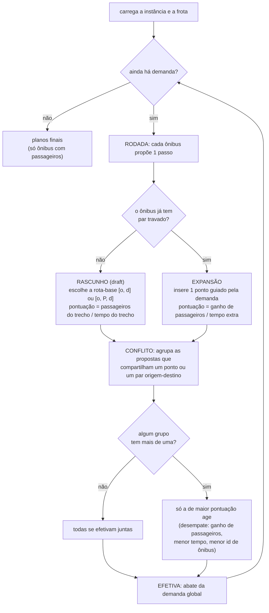
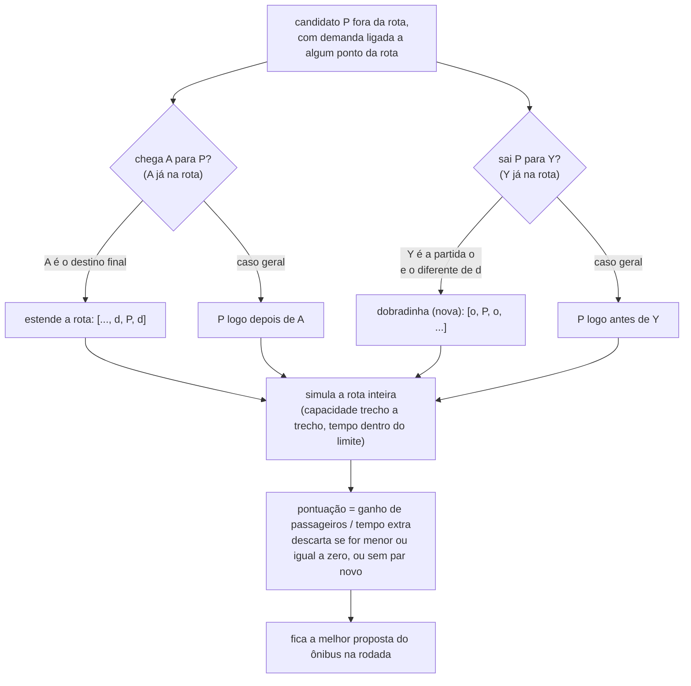

# Heurística TOP UNIVASF — visão geral

O código é a fonte da verdade (`algorithms/top_UNIVASF.py`); o passo a passo
completo, em pseudocódigo, está em `heuristica_pseudocodigo.txt`.

## 1. Fluxo principal (a rodada)

## 2. Detalhe da expansão (onde o ponto novo entra)

## Legenda

- **rascunho (draft)** — ônibus sem par travado escolhe a rota-base; a rota
  nasce na origem do par (sem deslocamento vazio).
- **expansão** — ônibus com par travado insere 1 ponto; a posição vem da
  demanda. A **dobradinha** `[o, P, o, ...]` é o caso em que a demanda é
  `P→o` (sair para a partida) e a rota não termina na partida — é a única
  posição que revisita a origem.
- **conflito** — propostas que compartilham chave (ponto ou par
  origem-destino) caem no mesmo grupo, direto ou por transitividade.
- **pontuações** — rascunho: `passageiros do trecho ÷ tempo do trecho`;
  expansão: `ganho de passageiros ÷ tempo extra`. O relatório final usa
  `passageiros totais ÷ tempo total`.
