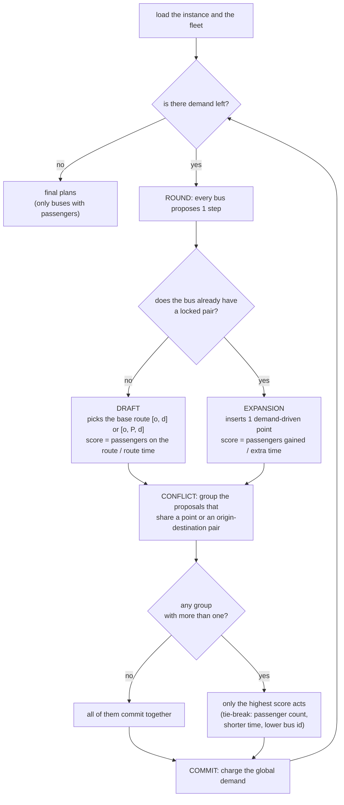
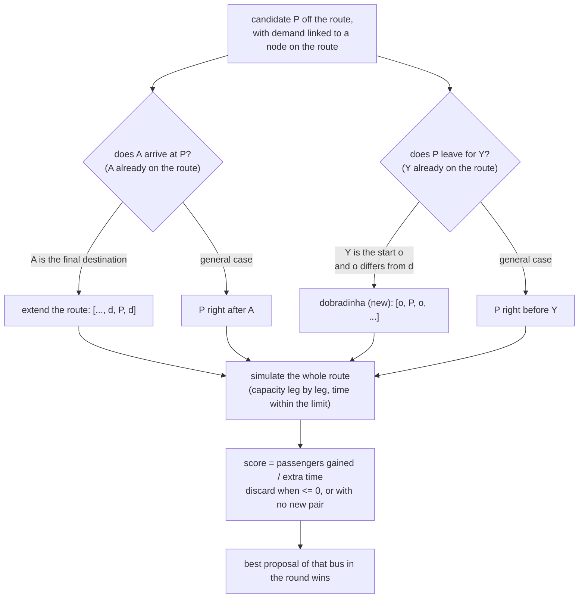

# UNIVASF TOP heuristic — overview

The code is the source of truth (`algorithms/top_univasf/`); the full
step-by-step pseudocode is in `heuristics_pseudocode.md`.

## 1. Main flow (the round)

## 2. Expansion detail (where the new point enters)

## Legend

- **draft** — a bus without a locked pair picks the base route; the route is
  born at the pair origin (no deadhead).
- **expansion** — a bus with a locked pair inserts 1 point; the position comes
  from the demand. The **dobradinha** `[o, P, o, ...]` is the case where the
  demand is `P→o` (leaving for the start) and the route does not end at the
  start — the only position that revisits the origin.
- **conflict** — proposals sharing a key (point or origin-destination pair)
  fall into the same group, directly or by transitivity.
- **scores** — draft: `passengers on the route ÷ route time`; expansion:
  `passengers gained ÷ extra time`. The final plan reports
  `total passengers ÷ total time`.
