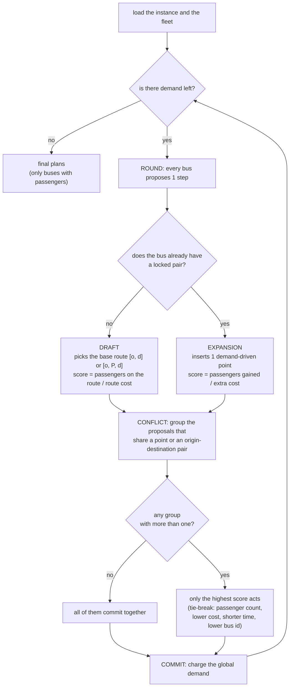
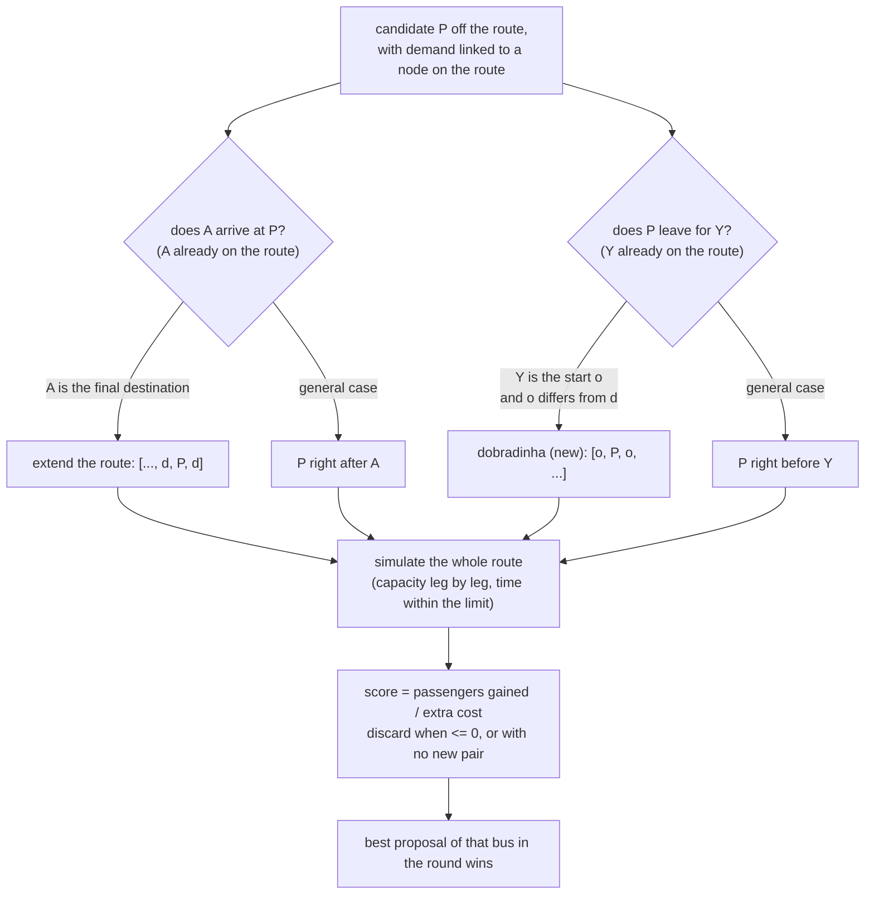

# UNIVASF TOP heuristic — overview

The code is the source of truth (`algorithms/top_univasf/`); the full
step-by-step pseudocode is in `heuristics_pseudocode.md` (in Portuguese).

## 1. Main flow (the round)

## 2. Expansion detail (where the new point enters)

## Legend

- **draft** — a bus without a locked pair picks the base route; the route is
  born at the pair origin (no deadhead).
- **expansion** — a bus with a locked pair inserts 1 point; the position comes
  from the demand. The **dobradinha** `[o, P, o, ...]` is the case where the
  demand is `P→o` (leaving for the start) and the route does not end at the
  start — the only position that revisits the origin.
- **conflict** — proposals sharing a key (point or origin-destination pair)
  fall into the same group, directly or by transitivity.
- **scores** — draft: `passengers on the route ÷ route cost`; expansion:
  `passengers gained ÷ extra cost`. The final plan reports
  `total passengers ÷ total cost` (passengers per real).

## 3. Objective (cost)

TOP has a single objective: passengers per real (R$). Each bus still respects
its own capacity, and pays fuel with its own km per liter plus the driver, both
priced by the scenario. Maximising passengers per real is equivalent to
minimising the cost per passenger of that candidate; this greedy ratio does not
prove a globally minimum fleet cost. In expansion it ranks the cost per extra
passenger. `solve_scenario` builds the `CostModel` from the
scenario and `run_fleet` requires it, so every bus's autonomy is part of the
decision.

## 4. Clarke-Wright as an adapted baseline

CW is reported as a baseline adapted to this OD passenger problem, not as a
faithful reproduction of the published OVRP solver. Construction still merges
customer orders using distance savings. Pickup and drop-off nodes are both active.
The static load is all OD demand touching any customer stop, counting each pair
once. Merges must fit that load and the active time constraint. Chosen origin and
destination anchors are endpoints rather than customers of the static load;
both endpoint legs and their passengers are included in travel and boarding.

Selection uses `solution_key(served, cost) = (-served, cost)` everywhere: more
service first, full fuel-plus-driver cost only as a tie-breaker. Anchoring tests
both order directions and allowed endpoint pairs by exact boarding. The lambda
sweep and CW-3 also use exact boarding. The two-phase inner loop uses an optimistic
OD-order `service_bound`, not simulated attendance: it ignores seat contention and
unions allowed anchoring alternatives, counting each OD pair at most once. Its
record candidates, including the initial construction, undergo exact final
selection after anchoring/fleet selection. A higher bound cannot by itself force
a service regression relative to that incumbent. This approximation does not
guarantee discovery of the best solution among every sampled order.

Pipeline per lambda: construction -> anchoring -> fleet cut -> exact selection.
The selected fleet then undergoes CW-3 -> final evaluation. CW-3 preserves its
chosen endpoints; no later anchoring rebuild discards its improvements. Rejected
local-search candidates never mutate the incumbent. Exhausting all three
neighborhoods stops repeated identical searches early, within the 500-iteration cap.

The selection cap remains 5,000 iterations. Sampling is an explicit adaptation:
weighted roulette without replacement inside bounded tournament groups, implemented
with NumPy exponential races. This replaces the earlier sliding Python window,
while retaining distance-based savings and reproducible seed-driven sampling.
Context-local caches reuse static loads, paths and immutable merge templates;
results returned to callers are copied so mutation cannot poison later searches.

The controlled comparison uses the same homogeneous fleet, depot, time limits,
boarding simulator and fuel-plus-driver cost formula for both methods. The
standard fleet comparison retains an important asymmetry: TOP uses individual
vehicle capacities/autonomies, whereas CW constructs with the smallest capacity
and a reference cost model. Final report costs are computed per assigned bus.
Do not describe the standard experiment as isolating only the routing algorithm.

Savings measure distance, not the direction of OD flows. A visiting order can
therefore miss requests even when every pickup and drop-off is available. TOP
constructs from OD pairs, which explains its better demand alignment in the
reported scenarios. Capacity also affects coverage: restoring static touch-load
checks may reduce service relative to a version deferring capacity until boarding;
such a change must not be attributed to cost-based selection.

## 5. Measurement and reproducible reports

Generated Markdown reports omit current dates and measured durations (shown as
`—` rather than a fictitious zero). Fixed inputs and seed therefore yield identical
report bytes. Explicit render APIs still support dated/timed views for callers.
Measured wall times are kept separately by `scripts/validate_cw.py --metrics PATH`.
This validation runs sequentially, checks service, endpoints, actual travel time,
peak occupancy and fleet size, and compares all four report byte strings twice.
Timing claims apply to the measured environment, not every machine.
